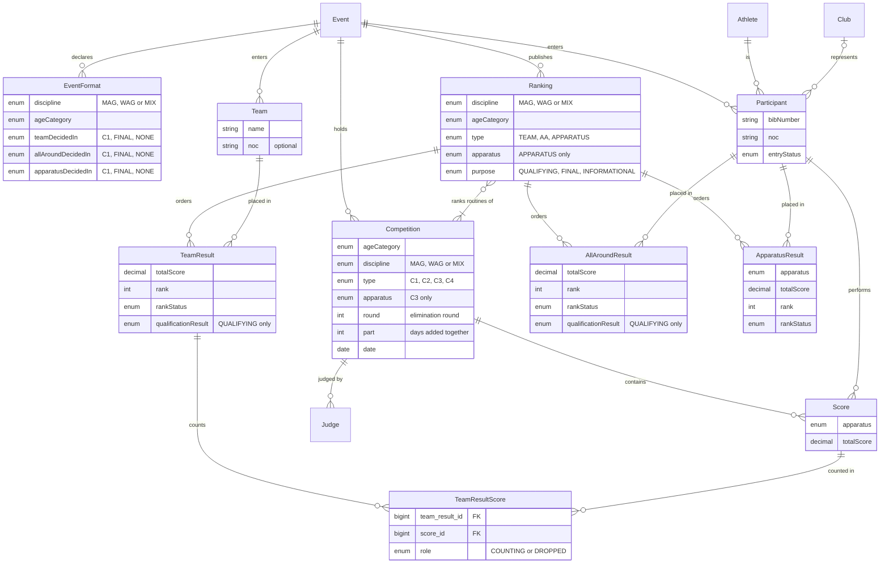

# Competition models

A design palette for deciding how each way a competition is run should be stored and shown.
It lists every meet parsed so far, what its first session decided, and how the files stored
it before the model change. The rules settled here move into
`instructions-results-parsing.md` §4.9 and `import-file-model.md` as each step lands.

**Rollout** (see §7):

| Step | What | Status |
|---|---|---|
| 1 | Schema and domain: `Competition`, `Ranking`, `Team`, `TeamResultScore`, rank status; data rebuilt by re-importing | Done ([data-model.md](data-model.md)) |
| 2 | Import file standard: `RANKING-*`, `C1`–`C4`, `Purpose`, `Rank Status`, format columns, `EventFormat`; the importer reads only the new files, and `convert_file_standard.py` makes the mechanical renames. The `Team` column moved to step 6 | Done ([import-file-model.md](import-file-model.md)) |
| 3 | Reshape the existing files: formats in `EVENT.csv`, `data/` converted, then `reshape_2026_files.py`: title-deciding `RANKING-QUAL` → `RANKING-FINAL` of `C1`, a rank status for every blank rank, Asian Championships' qualifying rankings dropped (the whole field in the final ranking); Europeans MAG JR all-around final ranking parsed. `CORRECTIONS.csv` keys move with the parsers in step 4 | Done |
| 4 | Parsers and the parsing doc: every parser writes the standard itself (`common.Output.ranking` names ranking files and sets purposes and rank statuses from the format), reproducing `data/` byte for byte; `CORRECTIONS.csv` keys converted; the step 2–3 scripts retired | Done ([instructions-results-parsing.md](instructions-results-parsing.md)) |
| 5 | API and front end aligned with the model: "session" becomes "competition" (`/api/competitions/{id}/results`); `round` becomes `type` (`C1`–`C4`); names, short names and slugs come from the rankings, with each ranking type's purpose in `purposes`; `rankStatus` on team and all-around results, shown as a code (HC, NR, INC, DNF, –) where the rank is blank; Q marks and medals follow the ranking's purpose | Done ([api-competition.md](api/api-competition.md)) |
| 6 | Youth Olympic Games, mixed team included | |

Sections 1–6 describe the model before step 1.

## 1. Terms

A meet's **first session** is the competition every entrant takes part in (what the books
usually call "Qualification"). For each title (team, all-around, each apparatus), it does one
of three things:

| Value | Meaning |
|---|---|
| **Qual** | It qualifies teams or athletes to a later round with its own routines, which decides the title. |
| **Final** | It decides the title itself. No later round has routines for that title. |
| **—** | The title isn't contested. |

Each title is exactly one of these, so Qual and Final are a toggle, with a third state for
titles that aren't held.

## 2. What each meet's first session decided

| Meet | Prefixes | Team | AA | Apparatus | Model |
|---|---|---|---|---|---|
| World Championships | MAG SR, WAG SR | Qual | Qual | Qual | A |
| European Championships | MAG SR | Qual | — (see §7.6, open) | Qual | B |
| European Championships | WAG SR | Qual | Final | Qual | C |
| Asian Games | MAG SR, WAG SR | Qual | Final | Qual | C |
| European Championships | MAG JR | Final | Qual | Qual | D |
| Pan American Championships | MAG SR, WAG SR | Final | Qual | Qual | D |
| Mediterranean Games | MAG SR, WAG SR | Final | Qual | Qual | D |
| Commonwealth Games | MAG SR, WAG SR | Final | Qual | Qual | D |
| Central American and Caribbean Games | MAG SR, WAG SR | Final | Qual | Qual | D |
| European Championships | WAG JR | Final | Final | Qual | E |
| Pan American Championships | MAG JR, WAG JR | Final | Final | Qual | E |
| African Championships | MAG/WAG JR, SR | Final | Final | Qual | E |
| Asian Championships | MAG/WAG JR, SR | Final | Final | Qual | E |
| South American Games | MAG SR, WAG SR | Final | Final | Qual | E |
| Oceania Championships | MAG/WAG JR, SR | Final | Final | — | F |
| US Championships | MAG JR16, JR17, SR; WAG JR, SR | — | Final (two days combined) | Final (two days combined) | G |
| Apparatus World Cups (Antalya, Baku, Cairo, Cottbus, Osijek) | MAG SR, WAG SR | — | — | Qual | H |
| World Challenge Cups (Koper, Paris, Szombathely, Tashkent, Varna) | MAG SR, WAG SR | — | — | Qual | H |

Models:

- **A.** Every title is decided in a final.
- **B.** As A, but without an all-around title.
- **C.** The team title goes to a final. The all-around title is decided in the first session.
- **D.** The team title is decided in the first session. The all-around title goes to a final.
- **E.** The team and all-around titles are decided in the first session. Apparatus finals follow.
- **F.** One session decides everything. There are no apparatus titles and nothing follows it.
- **G.** The all-around is competed twice, on two days. The all-around and apparatus titles go
  to the combined totals. There is no team title.
- **H.** Apparatus titles only.

## 3. How each is stored today

Session codes are the `Round` values. "Routines" means the session holds `SCORES-*` files. A
summary "in AA (Scores Round QUAL)" means an AA session holding only standings that rank the
QUAL routines.

| Model | Meet | Routines in | Team title standings | AA title standings |
|---|---|---|---|---|
| A | Worlds | QUAL, TEAM, AA, EVENT | `SUMMARY-FINAL-TEAM` in TEAM (own routines) | `SUMMARY-FINAL-AA` in AA (own routines) |
| B | Europeans MAG SR | QUAL, TEAM, EVENT | `SUMMARY-FINAL-TEAM` in TEAM | — |
| C | Europeans WAG SR | QUAL, TEAM, EVENT | `SUMMARY-FINAL-TEAM` in TEAM | **`SUMMARY-QUAL-AA` in QUAL** |
| C | Asian Games | QUAL, TEAM, EVENT | `SUMMARY-FINAL-TEAM` in TEAM | **`SUMMARY-FINAL-AA` in AA (Scores Round QUAL)** |
| D | Europeans MAG JR | QUAL, AA, EVENT | `SUMMARY-QUAL-TEAM` in QUAL | none built (§6 item 2) |
| D | Pan Ams SR, Med Games, Commonwealth, CAC Games | QUAL, AA, EVENT | `SUMMARY-QUAL-TEAM` in QUAL | `SUMMARY-FINAL-AA` in AA (own routines) |
| E | Europeans WAG JR, Pan Ams JR, African | QUAL, EVENT | **`SUMMARY-QUAL-TEAM` in QUAL** | **`SUMMARY-QUAL-AA` in QUAL** |
| E | Asian Championships | QUAL, EVENT | **both**: `SUMMARY-QUAL-TEAM` in QUAL, and `SUMMARY-FINAL-TEAM` in TEAM (Scores Round QUAL) | **both**: `SUMMARY-QUAL-AA` in QUAL, and `SUMMARY-FINAL-AA` in AA (Scores Round QUAL) |
| E | South American Games | QUAL, EVENT | **`SUMMARY-FINAL-TEAM` in TEAM (Scores Round QUAL)** | **`SUMMARY-FINAL-AA` in AA (Scores Round QUAL)** |
| F | Oceania | AA | `SUMMARY-FINAL-TEAM` in TEAM (Scores Round AA) | `SUMMARY-FINAL-AA` in AA |
| G | US Championships | AA Part 1, AA Part 2 | — | `SUMMARY-FINAL-AA` in AA (Part 1 and 2 rows, plus combined rows with Part blank); `SUMMARY-FINAL-<APP>` for apparatus titles |
| H | World Cups | QUAL, EVENT | — | — |

The rows in bold show where the same model is stored in different ways.

## 4. How the all-around field is ranked when the first session decides the title

Rows for athletes who missed out under two-per-country, or who competed outside the
competition, appear in one of several ways.

| Meet | Model | What the summary holds | Two-per-country athletes | Q/R/NR markers |
|---|---|---|---|---|
| Europeans WAG SR | C | 91 rows, all ranked | not visible: whole field ranked as printed | none |
| Asian Games | C | MAG 23 rows / 5 unranked; WAG 38 / 14 | listed with totals, rank blank | none |
| Europeans WAG JR, Pan Ams JR, African | E | whole field, partial all-arounds unranked | not visible: whole field ranked as printed | none |
| Asian Championships | E | QUAL-AA: whole field ranked; FINAL-AA: only the 24 who counted | QUAL-AA: ranked, marked `NR`; FINAL-AA: left out | Q/R/NR on QUAL-AA, though no later AA round had routines |
| South American Games | E | MAG 23 rows / 6 unranked; WAG 26 / 10 | listed with totals, rank blank (WAG via RANK corrections) | none |
| Oceania | F | every all-arounder | none applied | none |

Other things seen:

- **Hors concours.** The Asian Championships MAG SR qualification lists two AUS guests with full
  all-around totals and no rank.
- **Partial all-arounds.** Every meet leaves them unranked, with a blank or partial total.
- **US Part 2 rows.** These are unranked because the book prints no per-day places on day 2.
  (Of 42 unranked MAG SR rows, 32 are full all-arounds.)

## 5. What the database can't tell apart

An `AllAroundResult` with a null rank can mean any of these:

1. A partial all-around (not every apparatus competed).
2. The athlete missed out under two-per-country.
3. Hors concours or a guest.
4. A day with no per-day places (US Part 2).
5. A DNF or withdrawal.

The site shows "–" for all of them and sorts them last. Nothing records which one it is.

## 6. Questions this raises

1. **Where do a first-session title's standings live?** Three answers exist today for model E:
   - in QUAL (African),
   - in both QUAL and a final-only session (Asian Championships),
   - in the final-only session only (South American Games).

   Models C and D have the same split: Europeans WAG SR AA versus Asian Games AA, and Pan Ams
   SR team versus South American Games team.
2. **Should the site show a "Team Final" / "All-Around Final" for a title decided in the first
   session?** If yes, every Final-state title gets a final-only session (`Scores Round QUAL`).
   If no, the standings stay in QUAL and the session's name has to say it decided the title.
3. **Two-per-country.** Should every Final-state all-around list the whole field? If so,
   athletes who missed out would be marked as such rather than given a blank rank, and when a
   book prints both, the whole-field rank would sit alongside the title rank.
4. **Q/R/NR on a Final-state title.** Should they be kept or dropped? So far only the Asian
   Championships print them.
5. **Models F and G** store the first session as `AA`, not `QUAL`, because nothing follows it.
   Is that still right once model E has a rule? Model F is model E without apparatus finals.

## 7. Proposed model

### 7.1 Why the current model can't say how a meet was run

`Session` stands for two things at once:

- **a competition**: where and when routines were performed (`Score` rows), and
- **a ranking**: standings over those routines (`TeamResult`, `AllAroundResult`,
  `ApparatusResult`).

When the first session decides a title, the two come apart, and each meet got its own
workaround:

- **Final-only sessions** (`scoresSession`, V7; SA Games, Asian Championships). These are
  sessions that were never competed, with dates and page addresses.
- **Qualification summaries that are really the title** (African, Europeans WAG). Nothing
  marks them as the title.
- **Single rounds stored as `AA`** (Oceania, US). The code was picked for the name the site
  shows.

As a result, the database can't say:

- where a title was decided;
- whether a title was not held or simply never parsed;
- why a rank is blank.

It also accepts Q/R/NR on standings that qualified nobody.

### 7.2 Changes

1. **Sessions become `Competition`s, and are competitions only.** A competition has a date, a
   part, judges and routines.
   - Its `type` (today `Round`) says which competition it was, using FIG's numbering (§9):

     | Code | Competition |
     |---|---|
     | `C1` (today `QUAL`) | Competition I, which every entrant competes in |
     | `C2` (today `AA`) | Competition II, the all-around final |
     | `C3` (today `EVENT`) | Competition III, the apparatus finals |
     | `C4` (today `TEAM`) | Competition IV, the team final |

   - `C1` doesn't claim to be a qualification. Oceania's and the US's single round is `C1`, like
     everyone else's.
   - `scoresSession` goes away.
2. **A new `Ranking` entity holds standings.** It has:
   - a **type** (`TEAM`, `AA`, `APPARATUS` + apparatus): *what* is ranked;
   - a **purpose**: *what the standings are for*:
     - `QUALIFYING` picks who goes to a later round (Q/R/NR allowed);
     - `FINAL` gives the final placings and medals;
     - `INFORMATIONAL` orders results but decides nothing (vault's single-vault list in
       qualification; the US day-by-day all-around rankings).

   There is one ranking per competition, type, apparatus and purpose.

   It ranks the routines of one or more sessions (more than one for a mixed team, below).
   `TeamResult`, `AllAroundResult` and `ApparatusResult` belong to a ranking, not a session.
3. **The format is declared per event, discipline and age category** (`EventFormat`). These are
   your toggles, saying where each title was decided:
   - **Team:** `C1`, `FINAL` or `NONE`.
   - **All-around:** `C1`, `FINAL` or `NONE`.
   - **Apparatus:** `C1`, `FINAL` or `NONE`.

   `C1` means Competition I decided the title. `FINAL` means the title's own final decided it
   (Competition II, III or IV). `NONE` means it wasn't held. The importer checks the files
   against it:
   - a title declared with no `FINAL` ranking is an error (this catches Europeans MAG JR AA,
     never parsed);
   - a `FINAL` format with no final session is an error.
4. **A `rankStatus` on each result explains a blank rank.** Ranks stay exactly as printed.

   | Value | Meaning |
   |---|---|
   | `RANKED` | has a rank |
   | `INCOMPLETE` | a partial all-around, or a team short of counting scores |
   | `NOC_LIMIT` | missed out under two-per-country (or a final's per-country limit) |
   | `HORS_CONCOURS` | a guest or out-of-competition entry |
   | `DID_NOT_FINISH` | withdrew partway |
   | `UNPLACED` | the source prints no places (US Part 2 rows) |
5. **Q/R/NR only on `QUALIFYING` rankings.** On a `FINAL` ranking, NR becomes the `NOC_LIMIT`
   `rankStatus`.
6. **Teams become entities.** A `Team` has a name and an optional NOC. Its members aren't
   stored: they're the gymnasts with a score linked to any of its results (`TeamResultScore`).
   (A `TeamMember` table was proposed and dropped in step 1, since it would repeat the links.)
   - Today a team is just an NOC string on `TeamResult`, with its members implied by
     `Participant.noc`. That breaks for Europeans' `WG1`/`WG2` and for **mixed teams**.
   - A mixed team has MAG and WAG members, so its ranking ranks routines from sessions of both
     disciplines. That's why a ranking can link to more than one session, and why its discipline
     can be `MIXED`.
   - Mixed teams may need more modelling: line-ups, and whether the team counts across
     disciplines. Leave them open until we look at a book, such as the Youth Olympic Games.
7. **Session names on the site come from the rankings.** For example:

   | Session | Name |
   |---|---|
   | Worlds' C1 | "Qualification" |
   | SA Games' C1 | "Team and All-Around Final · Apparatus Qualification" |
   | Oceania's C1 | "Team and All-Around Final" |

   No session is called a final it wasn't. Done in step 5: the rule, and the slugs, are in
   [api-competition.md](api/api-competition.md#names-and-slugs).

Apparatus standings inside a session stay on `Score` (`rank`, `qualificationRank`,
`qualificationResult`). An `APPARATUS` ranking is needed only where standings combine
sessions, as with the US two-day totals (today's `ApparatusResult`). Whether every apparatus
ranking should also become a `Ranking` row, for uniformity, is a later choice.

**Competition versus ranking.** A competition is something that *happened*: gymnasts
performed routines on a date, in front of judges. A ranking is an *ordering* of those routines'
results, by a rule and for a purpose. Scores and judges belong to competitions. Ranks, Q/R/NR
and standings belong to rankings. They need to be separate because they don't pair up one to
one:

| Case | Competitions | Rankings |
|---|---|---|
| Worlds C1 | 1 | 9: team, AA, six apparatus, plus vault's single list |
| SA Games C1 | 1 | team `FINAL`, AA `FINAL`, apparatus `QUALIFYING` and more |
| US combined all-around | 2 (Part 1, Part 2) | 1 |
| Mixed team qualification | 2 (MAG C1, WAG C1) | 1 |
| Worlds team final | 1 | 1 |

Only the finals pair up one to one, and that is the case today's model was built around.

### 7.3 Entity diagram (proposed)

Bold relationships are new. `Event`, `Athlete`, `Club`, `Judge` and `ImportRun` are unchanged
and partly omitted.

**How to read the lines.** Each line joins two entities. The marks at each end say how many of
the entity at *that* end go with one of the other.

| Mark | Meaning |
|---|---|
| `\|\|` | exactly one |
| `\|o` / `o\|` | zero or one |
| `\|{` / `}\|` | one or more |
| `o{` / `}o` | zero or more |

For example:

- `Event ||--o{ Competition`: one event holds zero or more competitions, and each competition
  belongs to exactly one event.
- `Ranking }o--|{ Competition`: a ranking ranks the routines of one or more competitions (two
  for a mixed team), and a competition can be ranked by zero or more rankings.

**Which table holds which row.** These are the rows for one apparatus in a qualification
(Worlds MAG C1, floor, 100 gymnasts), under §7.6 decision 4:

| Table | Rows | One row is |
|---|---|---|
| `Score` | 100 | one gymnast's routine: D, E, penalties, total (for vault, both vaults) |
| `Ranking` | 1 | "C1 floor, `QUALIFYING`" |
| `ApparatusResult` | 100 | one gymnast's place in that ranking: rank, rankStatus, Q/R/NR, total |

The all-around works the same way already: `Score` holds the routines, and `AllAroundResult`
holds each gymnast's place in the all-around ranking. "One extra row per score" means the
`ApparatusResult` row. `Score` doesn't change in number.

### 7.4 The models as competitions and rankings

| Model | Example | Competitions | Rankings |
|---|---|---|---|
| A | Worlds | C1, C4, C2, C3×n | C1: team and AA `QUALIFYING`. C4: team `FINAL`. C2: AA `FINAL` |
| C | Asian Games | C1, C4, C3×n | C1: team `QUALIFYING`, **AA `FINAL`**. C4: team `FINAL` |
| D | Commonwealth | C1, C2, C3×n | C1: **team `FINAL`**, AA `QUALIFYING`. C2: AA `FINAL` |
| E | SA Games, African | C1, C3×n | C1: **team `FINAL`, AA `FINAL`** |
| E | Asian Championships | C1, C3×n | C1: team and AA `FINAL` only; the printed qualifying rankings aren't stored (§7.6) |
| F | Oceania | C1 | C1: team `FINAL`, AA `FINAL` |
| G | US | C1 part 1, C1 part 2, C1 | C1 parts: AA per day, `INFORMATIONAL`. C1 whole: AA `FINAL`, apparatus `FINAL` (combined) |
| H | World Cups | C1, C3×n | none beyond the scores' own ranks |

### 7.5 Files

- **`SUMMARY-*` files become `RANKING-*`.** `RANKING-QUAL-<X>` and `RANKING-FINAL-<X>` map to
  `QUALIFYING` and `FINAL` rankings. On a FINAL ranking file, the competition column (today
  `Round`) names the competition whose routines it ranks, which replaces `Scores Round`.
- **Competition codes in files.** `SCORES-QUAL-*`, `-AA-*`, `-EVENT-*` and `-TEAM-*` become
  `SCORES-C1-*`, `-C2-*`, `-C3-*` and `-C4-*`.
- **A new `Rank Status` column.** It's blank when the row is ranked.
- **`EVENT.csv`** gains `Team Format`, `AA Format` and `Apparatus Format`.
- **A `Team` column** (team name) on summaries and scores. It's needed only where a team isn't
  simply the NOC, such as mixed teams. (Moved to step 6: every team so far, `WG1`/`WG2` and
  each YOG mixed team included, is one NOC.)
- **A `Purpose` column** on ranking files (added in step 2), so a file states its own context:
  `QUALIFYING`, `FINAL`, or `INFORMATIONAL` on a split competition's part rows.
- **Re-shaping existing files:**
  - title-deciding `SUMMARY-QUAL-*` become `RANKING-FINAL-*` with competition `C1` (African,
    Pan Ams, Europeans, Commonwealth, Mediterranean Games, CAC Games);
  - Oceania and US `AA` become `C1`;
  - `QUAL`, `AA`, `EVENT` and `TEAM` become `C1`–`C4` everywhere.

### 7.6 Decisions and open questions

Decided:

1. **The `Ranking` entity.** Yes.
2. **Format values.** `C1` / `FINAL` / `NONE`.
3. **One ranking per title and purpose.** Where a book prints a qualifying ranking and a final
   ranking over the same routines for a title Competition I decided (Asian Championships),
   only the `FINAL` ranking is stored.
   - It holds the whole field, as the Asian Games and SA Games summaries do.
   - Athletes the book marked `NR` get the `NOC_LIMIT` `rankStatus`.
   - The Q/R/NR markers are dropped, since they qualified no one to a later round.

4. **Places outside the final ranking.** Where the final ranking printed fewer places than the
   field (Asian Championships: 24 athletes, 8 teams), the rest are unranked with `UNPLACED`.
   Places from the qualifying ranking aren't borrowed.
5. **Apparatus rankings are rankings.** Every set of standings has the same shape: a `Ranking` with
   result rows (`TeamResult`, `AllAroundResult`, `ApparatusResult`).
   - `Score` keeps only the routine values.
   - Its `rank`, `qualificationRank` and `qualificationResult` move to `ApparatusResult`.

   The previous wording, kept for reference: Today an apparatus's standings are kept on the scores themselves:
   - an apparatus final's places are `Score.rank` in the EVENT session;
   - a qualification's per-apparatus places, the vault two-vault ranking and the Q/R/NR
     markers are `Score.rank`, `Score.qualificationRank` and `Score.qualificationResult`.

   Team and all-around standings are separate rows (`TeamResult`, `AllAroundResult`), because
   they sum several scores. The question is whether apparatus standings should also become
   `Ranking` + `ApparatusResult` rows, so that every set of standings has the same shape:
   - **For:**
     - one way to ask "who won what, and where was it decided";
     - a `rankStatus` on apparatus results (`NOC_LIMIT` for apparatus two-per-country, now an
       `NR` marker on a score);
     - the vault qualifying ranking stops needing its own `qualificationRank` column.
   - **Against:** one extra row per score in every session, repeating the score's total. The
     scores would then hold only routine values.

   Recommend making them rankings, for uniformity, unless the duplication bothers you.
6. **Vault's two lists are two rankings.** In qualification, the same vault scores are ranked
   twice:
   - the single-vault list (first vault, which counts for the all-around), `INFORMATIONAL`,
     with every vaulter;
   - the two-vault list (the average), `QUALIFYING` with Q/R/NR, only for those who did two
     vaults.

   Each is written only when the book prints it. This keeps both ranks that today sit on the
   score row (`rank`, `qualificationRank`).

7. **Terminology** (§9).

8. **Mixed teams** are modelled in §8.

Decided in step 3:

9. **Unranked rows below a printed top** (Asian Games, South American Games: 24 ranked, two per
   country): `NOC_LIMIT` when two compatriots are ranked and the total beats the lowest ranked
   total, otherwise `UNPLACED`.
10. **An entry who started no apparatus** but is listed in an all-around ranking (Worlds MAG,
    Commonwealth MAG, Pan Ams WAG JR, Asian Championships MAG JR): `INCOMPLETE`.

Open:

- **Europeans MAG SR all-around.** The title exists and Competition I decided it: the book's
  medallists (gold KOVTUN Illia, CRO) are dated on qualification day. But the senior book prints
  no all-around ranking, only the three medallists. For now the AA format is `NONE`, which is
  knowingly wrong. Options: store the medallists as a `FINAL` ranking of `C1` (the other
  all-arounders `UNPLACED`), compute the ranking from the scores (a correction, since ranks are
  otherwise copied as printed), or leave it.

## 8. Mixed teams (Youth Olympic Games, Dakar 2026)

Source: `data/2026/2026-YOUTH-OLYMPIC-GAMES/18178-ResultsbookMedia.pdf` (123 pages, FIG
layout). The format is on pages 3–6, the mixed team on pages 103–119. Rules:
[Rules for the Youth Olympic Games 2026](https://www.gymnastics.sport/publicdir/rules/files/en_1.7%20-%20Rules%20for%20the%20Youth%20Olympic%20Games%202026.pdf).

### 8.1 How the YOG ran

**MAG and WAG.** These follow model A without apparatus finals. The book says "the apparatus
finals have been replaced by team finals and a Mixed Team event".

| Day | Competition |
|---|---|
| 7 Nov (men), 8 Nov (women) | C1 |
| 9 Nov | Team final (C4): top 8 teams, three a team, two counting per apparatus |
| 10 Nov | All-around final (C2): top 18 |

Format: team `FINAL`, AA `FINAL`, apparatus `NONE`.

**Mixed team.** One NOC is one mixed team.

- **Qualification has no routines of its own.** A ranking (pages 104–109) is built from the MAG
  and WAG C1 routines:
  - only MAG FX, PB, HB and WAG UB, BB, FX count;
  - each NOC counts its best single score per apparatus;
  - each apparatus total carries a printed rank in parentheses;
  - the top 12 are marked Q;
  - an NOC without a full set is `DNF` and unranked.

  It lists every gymnast the NOC entered (CHN: three women, three men).
- **The final is three rounds on 11 Nov.** Each round is its own competition with its own
  routines, start list and results (`QFNL`, `SFNL`, `FNL` in the footers). One judges
  assignment covers all three.
  - In each round a pair (one man, one woman) does one apparatus each, and the team total is
    the sum of the two scores.
  - Scores reset each round. Rounds 1 and 2 mark Q for the top 8 and top 4.
  - Round 1 prints places 9–12 for the teams it eliminates, and round 2 prints places 5–8.
  - Round 3 decides the medals.
  - Both members can't do FX in the same round. Each gymnast uses all three of their apparatus
    across the final (round 3 prints `CR-1`/`CR-2`, "completed in round 1/2", for the rest).
- **Medallists are the counting gymnasts plus the final pair** (page 7).
  - CHN gold: CHEN Ziyan, XIE Guying, ZHONG Qi, YANG Lanbin. These are the four whose scores
    counted in the mixed qualification. YANG and CHEN also made up the final pair.
  - LI Lezheng and ZHAO Ruiyang, entered but not counting, aren't medallists.
  - JPN's five medallists follow the same rule.

### 8.2 What fits the proposed model

| Need | How the model takes it |
|---|---|
| A ranking with no routines of its own, across two disciplines | `Ranking` (type `TEAM`, discipline `MIX`, purpose `QUALIFYING`) over the MAG C1 and WAG C1 competitions. This is the many-to-many from §7.3. |
| Final rounds | Each round is a `Competition` (type `C4`, discipline `MIX`). Rounds 1 and 2 have a `QUALIFYING` team ranking, round 3 a `FINAL` one. |
| A team that isn't one discipline | `Team`, with members derived from its score links (§7.2, point 6) |
| `DNF` NOCs in qualification | rank status `INCOMPLETE` |
| A title outside MAG and WAG | an `EventFormat` row for discipline `MIX`: team `FINAL`, AA `NONE`, apparatus `NONE` |

### 8.3 What the model needs added

1. **Discipline `MIX`** for `Competition`, `Ranking` and `EventFormat`. A score's own
   discipline comes from its athlete, since floor exists in both.
2. **`Competition.round`**: an elimination round (1, 2, 3) within one competition type, with
   scores reset.
   - It's not `part`. Parts are added together (US), while rounds eliminate.
   - The name frees up because `Round` becomes `type` (§9).
3. **A score's team role belongs to a ranking, not to the score.** The same C1 score can count
   for one ranking and be dropped by another. ZHAO Ruiyang's FX (13.666) counts for CHN's men's
   team (FX total 27.432 = YANG 13.766 + ZHAO 13.666). It's dropped from CHN's mixed team,
   which counts only YANG's best single score.
   - So `Score.teamScoreRole` (V8) moves to a new link, **`TeamResultScore`** (team result,
     score, role `COUNTING`/`DROPPED`).
   - This also gives the medallists: the members whose scores count in any of the team's
     rankings.
4. **Files.** A mixed prefix (e.g. `2026-YOUTH-OLYMPIC-GAMES-MIX-JR`) whose import uses the MAG
   and WAG prefixes' participants, so it's imported after them.
   - Its files need the discipline beside the apparatus, because floor appears twice: columns
     `MAG FX Total`, `WAG FX Total`, and scores files named by discipline and apparatus, or
     with a `Discipline` column.
   - The per-apparatus ranks in parentheses fit an `INFORMATIONAL` apparatus ranking within the
     team ranking, or can be left out.

### 8.4 Decisions and recommendations

Decided:

1. **Medallists are derived** from `TeamResultScore`, not stored.
2. **Mixed team members** are only the gymnasts who counted in qualification or competed in a
   final round.

3. **Final placings 5–12 stay where the book prints them.**
   - The round 3 `FINAL` ranking holds its 4 teams.
   - Places 5–8 stay in the round 2 ranking and places 9–12 in the round 1 ranking, both
     `QUALIFYING`, as printed.
   - The site shows the overall classification by reading back through the rounds: round 3's
     places, then the teams round 2 eliminated, then those round 1 eliminated. Every place
     shown is one the book printed; nothing is computed or stored twice.
4. **Per-apparatus ranks inside a team ranking aren't stored.**
   - The mixed qualification prints each NOC's place on each apparatus in parentheses, e.g.
     CHN "(1) 13.766" on men's floor.
   - For men's PB and HB it prints `(0)` for every NOC, which is clearly a printing fault. The
     right values are printed nowhere, so a correction would have to compute them.
   - Regular team rankings print the same parenthesised ranks, and we already don't store them
     (`SUMMARY-*-TEAM` and `TeamResult` have no apparatus ranks).
   - Leaving them out for mixed teams too is consistent, and makes the fault irrelevant. The
     apparatus totals are still kept in the file and checked.

## 9. Terminology

Decided. These are the terms for the new model. Sections 1–6 describe today's model and keep
today's terms. The renames land together with the model change, in one migration.

### 9.1 Competitions

FIG's Technical Regulations number a meet's competitions I to IV:

| Code | FIG name | What it is | Today |
|---|---|---|---|
| `C1` | Competition I | The competition every entrant takes part in. It may qualify to the finals, decide titles itself, or both. Usually called "Qualification". | `QUAL` (or `AA` for Oceania, US) |
| `C2` | Competition II | The all-around final | `AA` |
| `C3` | Competition III | The apparatus finals, one competition per apparatus | `EVENT` |
| `C4` | Competition IV | The team final | `TEAM` |

The site never shows these codes. It names a competition from the rankings it holds (§7.2,
point 7), for example "Qualification", "All-Around Final" or "Team and All-Around Final".

### 9.2 Glossary

| Term | Meaning | Replaces |
|---|---|---|
| **Event** | A meet: one entry on the calendar, such as the 2026 World Championships. FIG's word for it. | (kept) |
| **Apparatus** | Floor, pommel horse, vault and so on. "Event" is never used for an apparatus. | `Round.EVENT`, "event final" |
| **Competition** | Routines performed on a date, in front of judges: one of C1–C4, for one discipline and age category (and apparatus, for C3). | `Session` |
| **Competition type** | The `C1`–`C4` code. | `Round` |
| **Part** | A share of a competition held over several days and decided on the combined total (US Part 1, Part 2). | (kept) |
| **Round** | An elimination round within a competition, with scores reset each round (YOG mixed team final, rounds 1–3). | (new; the old `Round` is now the competition type) |
| **`MIX`** | The discipline of a mixed team's competitions, rankings and format: men and women together. | (new) |
| **Team result score** | How one score counts in one team result: `COUNTING` or `DROPPED`. | `Score.teamScoreRole` |
| **Score** | One gymnast's performance on one apparatus in one competition: a routine, or vault's two. | (kept) |
| **Ranking** | An ordering of one or more competitions' results by a rule, for a purpose. | standings held by `Session` |
| **Ranking type** | What is ranked: `TEAM`, `AA` or `APPARATUS` (+ apparatus). | |
| **Purpose** | What a ranking is for: `QUALIFYING` (picks who goes to a later competition; Q/R/NR), `FINAL` (final placings and medals), `INFORMATIONAL` (decides nothing). | |
| **Result** | One team's or gymnast's line in a ranking: `TeamResult`, `AllAroundResult`, `ApparatusResult`. | |
| **Rank status** | Why a result has or lacks a rank: `RANKED`, `INCOMPLETE`, `NOC_LIMIT`, `HORS_CONCOURS`, `DID_NOT_FINISH`, `UNPLACED`. | |
| **Event format** | For each event, discipline and age category, which competition decided each title: team, all-around and apparatus, each `C1`, `FINAL` or `NONE`. | |
| **Team** | A group of participants ranked together. Usually one NOC's team, but not always (mixed teams, `WG1`/`WG2`). | the NOC on `TeamResult` |
| **`SCORES-<code>-<apparatus>`** | Import file of one competition's scores, e.g. `SCORES-C3-FX`. | `SCORES-QUAL/AA/EVENT/TEAM-*` |
| **`RANKING-<QUAL\|FINAL>-<type>`** | Import file of one ranking. | `SUMMARY-*` |
