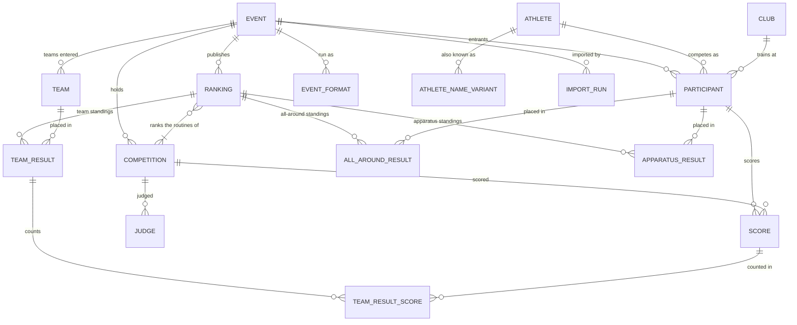

# Design: Elite Gymnastics Data Model

A data repository for elite mens and womens artistic gymnastics competitions and results. The data repository will contain the competitions, the participants and their scores.

This document outlines the data entity models.

## 1. Overview

`Event` is the named competition ("2026 European Championships"). A `Competition` is
something that *happened*: routines performed on a date in front of judges — FIG's
Competition I (qualification, which every entrant takes part in), II (all-around final),
III (one per apparatus final) or IV (team final). A `Ranking` is an *ordering* of one or
more competitions' results, by a rule and for a purpose: who goes on to a later
competition, a title's final placings, or an order that decides nothing.
`Participant` is one athlete's entry into the whole `Event` — bib and NOC are set once
per competition. `Score` is one routine (or vault's two) within a `Competition`.

Competitions and rankings don't pair up one to one, which is why both exist. A
qualification is one competition with several rankings (teams, all-arounders, each
apparatus, and vault's single-vault list); a two-day all-around (US Championships) and a
mixed team's qualification across the men's and women's competitions are one ranking
over two competitions; a team or all-around title decided in qualification is a ranking
of the qualification's routines, with no competition of its own. Why the model is shaped
this way: [competition-models.md](competition-models.md).

## 2. Enumerations

Every enum used below is defined once here and referenced by name in the entity
tables, rather than spelled out inline at each use.

Enums that are shown to users carry a `longName` display label (the **Long
Name** column below), exposed through `getLongName()`. Their `find(text)`
matches either the code or the long name, case-insensitively, so an import
file can use either one.

#### `Discipline`

| Value | Description |
|---|---|
| MAG | Men's Artistic Gymnastics |
| WAG | Women's Artistic Gymnastics |
| MIX | Men and women together: a mixed team's competitions, rankings and teams (2026 Youth Olympic Games). Never an athlete's discipline. |

#### `EventLevel`

| Value | Long Name | Description |
|---|---|---|
| OLYMPIC_GAMES | Olympic Games | |
| WORLD_CHAMPIONSHIPS | World Championships | |
| YOUTH_OLYMPIC_GAMES | Youth Olympic Games | |
| CONTINENTAL_GAMES | Continental Games | A continent's multi-sport games, e.g. Asian Games, Pan American Games |
| CONTINENTAL_CHAMPIONSHIPS | Continental Championships | e.g. European Championships |
| REGIONAL_GAMES | Regional Games | e.g. Mediterranean Games, Commonwealth Games |
| REGIONAL_COMPETITION | Regional Competition | e.g. Central American and Caribbean Games, South American Games |

These levels mix FIG's competition categories with its competition groups (Groups 1–4, in the
General Judges' Rules); how events are classified is still to be settled.
| WORLD_CUP | World Cup | |
| WORLD_CHALLENGE_CUP | World Challenge Cup | |
| INTERNATIONAL_TOURNAMENTS | International Tournament | Invitational events with international entries, below World Cup status |
| NATIONAL_CHAMPIONSHIPS | National Championships | A federation's own domestic championship, e.g. US Championships |
| DOMESTIC_COMPETITION | Domestic Competition | Other domestic, non-championship competition |
| UNKNOWN | Unknown | Used instead of leaving `Event.level` null when the tier can't be confidently classified at import time |

#### `CompetitionType`

| Value | Long Name | Description |
|---|---|---|
| C1 | Competition I | The competition every entrant takes part in, usually called "Qualification". It may qualify to the finals, decide titles itself, or both. |
| C2 | Competition II | The all-around final. |
| C3 | Competition III | An apparatus final; one `Competition` per apparatus. |
| C4 | Competition IV | The team final. |

FIG's own numbering (Technical Regulations). The code says which competition it was, not
what it decided: what a competition decided is in its rankings (§5), and the site names it
from them ([api-competition.md](api/api-competition.md#names-and-slugs)). An apparatus final's
apparatus lives on `Competition.apparatus`, matching how `Score` carries its own
`apparatus`. The import files use these codes too.

#### `TitleFormat`

| Value | Long Name | Description |
|---|---|---|
| C1 | Competition I | Competition I decided the title. |
| FINAL | Final | The title's own final decided it: Competition IV (team), II (all-around) or III (apparatus). |
| NONE | Not held | The title wasn't contested. |

Where a title was decided, per `EventFormat`.

#### `AgeCategory`

| Value | Description |
|---|---|
| SR | Senior |
| JR | Junior, for federations that don't subdivide further |
| JR16 | Junior, age-16 division — used by federations that subdivide (e.g. USA Gymnastics' domestic championships) |
| JR17 | Junior, age-17 division |

#### `Apparatus`

| Value | Long Name | Description |
|---|---|---|
| VT | Vault | Vault |
| UB | Uneven Bars | Uneven bars (WAG) |
| BB | Balance Beam | Balance beam (WAG) |
| FX | Floor Exercise | Floor exercise |
| PH | Pommel Horse | Pommel horse (MAG) |
| SR | Still Rings | Still rings (MAG) |
| PB | Parallel Bars | Parallel bars (MAG) |
| HB | Horizontal Bar | Horizontal/high bar (MAG) |

No `AA` value — all-around is a computed summary (`AllAroundResult`, §5), not a
judged apparatus result.

#### `ScoreStatus`

| Value | Long Name | Description |
|---|---|---|
| COMPLETED | Completed | The attempt was performed and scored normally. |
| DNS | Did Not Start | The athlete did not start / did not perform this apparatus. |
| INVALID_VAULT | Invalid Vault | The vault attempt was performed but ruled invalid (e.g. a board or landing-zone violation) and received no scored result. Applies to vault attempts only. |
| UNKNOWN | Unknown | |

#### `QualificationResult`

| Value | Long Name | Description |
|---|---|---|
| Q | Qualified | Qualified to the next round. |
| R1 | First Reserve | First reserve. Would advance if a qualified athlete withdraws. |
| R2 | Second Reserve | Second reserve. |
| R3 | Third Reserve | Third reserve. |
| R4 | Fourth Reserve | Fourth reserve (e.g. World Championships All-Around qualification). |
| NR | NOC Reserve | Had a score to qualify, but removed because of maximum of two per country in a final rule. "NOC Reserve" is FIG's own legend wording. |

#### `EntryStatus`

| Value | Long Name | Description |
|---|---|---|
| COMPETITOR | Competitor | Entered to compete. The default. |
| RESERVE | Reserve | Entered as a reserve (marked on the entry list); competes only if called up. |
| WITHDRAWN | Withdrawn | Struck through on the entry list. |
| HORS_CONCOURS | Hors Concours | Competes out of competition (marked `(Hors Concours)` / `(HC)` on the entry list): not ranked, and results books may leave their scores out (2026 Varna World Challenge Cup). |

#### `Country`

No enumerator or type will be used. Countries are the three-letter **IOC codes** World Gymnastics uses (`GER`, `NED`, `CRO`) — not ISO-3166 (`DEU`, `NLD`, `HRV`) — for both NOCs and an event's host country. At times, there will be FIG neutral athletes who are not associated with a country for the competition; they're published under a placeholder code, which can be four characters (`AIN1`, `AIN2` — Individual Neutral Athletes — at the 2026 Cottbus World Cup; `WG1`, `WG2` — World Gymnastics 1 and 2, each entering its own team — at the 2026 Europeans), so `Participant.noc` and `Team.noc` accept 3–4 characters.

#### `JudgeFunction`

| Value | Long Name | Description |
|---|---|---|
| PRESIDENT | President | Superior Jury |
| VICE_PRESIDENT | Vice President | Superior Jury |
| MEMBER | Member | Superior Jury |
| TD | Technical Delegate | Superior Jury: the FIG Technical Delegate, the whole Superior Jury at a World Cup (2026 Baku) |
| TDA | Technical Delegate Assistant | Superior Jury: the Technical Delegate's assistant (2026 Paris World Challenge Cup) |
| D1 | Difficulty Judge 1 | |
| D2 | Difficulty Judge 2 | |
| E1–E7 | Execution Judge 1–7 | One constant per execution judge, `E1` through `E7` |
| L | Line Judge | A panel's only line judge |
| L1 | Line Judge 1 | |
| L2 | Line Judge 2 | |
| T | Time Judge | A panel's only time judge |
| T1 | Time Judge 1 | |
| T2 | Time Judge 2 | |
| SV | Supervisor | Apparatus supervisor |
| DS1 | Difficulty Supervisor | The supervisor on a World Cup apparatus panel (2 D judges, 5 E judges, 1 supervisor), whose D-score the Superior Jury compares against the D-panel's |
| R | Reserve Judge | A single reserve the source doesn't number |
| R1–R6 | Reserve Judge 1–6 | Numbered reserve judges, `R1` through `R6` |

Codes as written in the `*-JUDGES.csv` files. When matching a code,
`JudgeFunction.find` also treats spaces and hyphens as underscores (e.g.
"Vice-President" → `VICE_PRESIDENT`). The unnumbered `L`/`T`/`R` forms are
used when the source lists only one of that role without a number. The
`L`, `T` and `SV` meanings were
confirmed by the 2026 World Championships Judges Assignments, which spell
them out ("Line Judge 1", "Time Judge", "Floor Exercise Supervisor").

## 3. Entities

### `Athlete`

| Field | Type | Nullable | Description |
|---|---|---|---|
| id | Long | No | Generated primary key. |
| licenseNumber | String | Yes | FIG license number assigned registered to athletes: from a results book, or the athlete reference files (`data/athletes/`) when no book prints it. |
| discipline | Discipline | No | The type of gymnastics program this athlete competes in. |
| surname | String | No | Athlete's family name, in written form ("Blakely", "McDonald", "van Pol") whatever capitalisation the source printed — FIG's capitalised surnames are converted by `PersonName`. |
| givenName | String | No | Athlete's given name, in the same written form. |
| birthplace | String | Yes | Where the athlete was born, when the source publishes it (rarely). A further way to tell apart athletes with the same name. |
| birthYear | Short | Yes | Birth year of the athlete — taken from `birthDate` when the source publishes a full date, otherwise from the year the source prints. Null when the source publishes neither (e.g. US Championships) and no athlete reference file gives a birth date. |
| birthDate | Date | Yes | Birth date of the athlete, when a results book publishes a full date; otherwise from the athlete reference files in `data/athletes/` (FIG's licenses, or hand-curated), applied after the results are imported. |

Unique key: `(surname, given_name, discipline)`. Neither `licenseNumber`
nor `birthYear` is part of it, since both can be null: athletes who only
compete nationally may have no FIG license (one is needed only for
international competition), and national results often publish no birth
year. Two different athletes with the same name in the same discipline
can't both be stored — none exist in the data so far. The athlete's country isn't stored here either; it's `Participant.noc`,
recorded per event.

### `AthleteNameVariant`

Additional names by which the athlete has had.

| Field | Type | Nullable | Description |
|---|---|---|---|
| id | Long | No | Generated primary key. |
| athleteId | Long, FK → `Athlete` | No | The athlete this alternate name belongs to. |
| surname | String | No | Family name, as published by the source, in the same written form as `Athlete.surname`. |
| givenName | String | No | Given name, as published by the source. |

Unique key: `(athlete_id, surname, given_name)`.

### `Event`

| Field | Type | Nullable | Description |
|---|---|---|---|
| id | Long | No | Generated primary key. |
| figEventNumber | String | Yes | FIG-assigned event code, when the event is FIG-sanctioned. Null for competitions run entirely by a domestic federation (e.g. a national championship). |
| slug | String | No | The event's name in addresses, e.g. `2026-world-championships`: lowercase words separated by hyphens, unique across events. The importer takes it from the manifest's name ([import-process.md](import-process.md)). |
| title | String | No | The event's name, e.g. "2026 European Championships." |
| shortName | String | No | A few words for where the title won't fit, such as an athlete's personal bests: the name readers use, then the year, e.g. `Euros 2026`. The events of one competition share it (the 2026 European Championships' four events are all `Euros 2026`). At most 40 characters. |
| startDate | LocalDate | No | First day of competition. |
| endDate | LocalDate | No | Last day of competition. |
| city | String | No | Host city. |
| countryCode | Country | No | Host country, as an IOC code (§2, `Country`). Distinct from any athlete's or team's NOC. |
| venue | String | Yes | Venue/arena name, when published. |
| apparatusSuppliers | String | Yes | The equipment manufacturer(s) supplying the apparatus, as published (e.g. `Spieth`). |
| level | EventLevel | No | The competitive tier of this event. Always set — `UNKNOWN` is used instead of leaving this null when the tier can't be confidently classified. |

Unique keys: `(title, start_date)` and `(slug)`. One `Event` can hold several disciplines'
competitions (the 2026 Worlds' MAG and WAG share one title, date, and FIG event
number), while sub-events published under their own titles (the 2026
Europeans' Senior and Junior championships) are separate `Event`s.

### `EventFormat`

How one discipline and age category of an event was run: where each title was decided.
It comes from the import manifest (`EVENT.csv`), and the importer checks the competitions
and rankings against it ([import-process.md](import-process.md#checks)).

| Field | Type | Nullable | Description |
|---|---|---|---|
| id | Long | No | Generated primary key. |
| eventId | Long, FK → `Event` | No | The event. |
| discipline | Discipline | No | |
| ageCategory | AgeCategory | No | |
| teamFormat | TitleFormat | No | Where the team title was decided. |
| allAroundFormat | TitleFormat | No | Where the all-around title was decided. |
| apparatusFormat | TitleFormat | No | Where the apparatus titles were decided. |

Unique key: `(event, discipline, age category)`. With no team or all-around title (both
`NONE`), Competition I is held one per apparatus, as at an apparatus World Cup.

### `Competition`

| Field | Type | Nullable | Description |
|---|---|---|---|
| id | Long | No | Generated primary key. |
| eventId | Long, FK → `Event` | No | The event this competition belongs to. |
| date | LocalDate | No | The calendar date it was held. Several competitions commonly share a date — e.g. several apparatus finals held on one day. |
| type | CompetitionType | No | Which of FIG's Competitions I–IV it was. |
| discipline | Discipline | No | The program competing. A WAG floor final and a MAG floor final are different competitions. `MIX` for a mixed team's competition. |
| ageCategory | AgeCategory | No | The age division competing. |
| apparatus | Apparatus | Yes | Set for an apparatus final (`C3`, one competition per apparatus) and for `C1` at an apparatus-format event (a World Cup), where qualification on each apparatus is its own competition with its own day and judges. Null otherwise: a championship's `C1`, `C2` and `C4` each cover every apparatus. |
| round | Integer | Yes | An elimination round within the competition, with scores reset each round (the 2026 Youth Olympic Games' mixed team final, rounds 1–3). Null when it isn't held in rounds. |
| part | Integer | Yes | A share of a competition held over several days and decided on the combined total (US Championships' two-day all-around: parts 1 and 2). Null means the competition as a whole: for the ordinary competition that's the only row, and for a split one it's an additional **whole row** holding the combined standings (see below). |

Unique key: `(event_id, type, discipline, ageCategory, apparatus, round, part)`,
declared `NULLS NOT DISTINCT`. A standard SQL unique constraint treats two
nulls as different values, and nearly every competition has a null `apparatus`,
`round` or `part`, so without it the key would never reject a duplicate.
`NULLS NOT DISTINCT` can't be expressed in a JPA annotation, so it lives
only in the Flyway migration. `CompetitionService.createCompetition` also checks
for a duplicate, to report it as a conflict rather than a SQL error.

**Competitions split into parts.** When a competition is held over several days
and decided on the combined total (US Championships: Day 1 + Day 2), it has one
row per part (`part` = 1, 2, …) holding the judged `Score`s, each with its day's
all-around standings, plus one whole row (`part` null) holding the combined
standings: an all-around ranking and an apparatus ranking per apparatus. The
whole row holds no `Score`s of its own, and its `date` is the first part's. (In
the model's final shape the combined rankings rank the parts directly and the
whole row goes; it stays until the API names pages from rankings.)

A title decided in another competition's routines has no competition of its own:
the 2026 Asian Championships' team and all-around finals, the 2026 South American
Games' and the 2026 Asian Games' all-around final ranked the qualification's
routines, so they are `FINAL` rankings of the `C1` competition (§5); the 2026
Oceania Championships' team title ranked the all-around final's.

### `Judge`

| Field | Type | Nullable | Description |
|---|---|---|---|
| id | Long | No | Generated primary key. |
| competitionId | Long, FK → `Competition` | No | The competition this judge served on. |
| discipline | Discipline | Yes | The discipline of the judge's panel, in a mixed competition only: its men's and women's panels both judge floor (2026 Youth Olympic Games). Null elsewhere, where the competition's discipline says it. |
| apparatus | Apparatus | Yes | Which apparatus this judge is assigned to within the competition. Null for a competition-wide role (e.g. Superior Jury `PRESIDENT`/`MEMBER`) rather than a per-apparatus panel seat. |
| function | JudgeFunction | No | The judge's role on the panel. |
| givenName | String | No | Judge's given name, as published by the source. |
| surname | String | No | Judge's family name, in the same written form as `Athlete.surname`. |
| nocCode | String | Yes | The federation/NOC this judge is credited to. Not always a 3-letter IOC code — a continental union appointing a Superior Jury (e.g. `EG` for European Gymnastics) or a neutral code (`AIN1`) is credited here too, so no fixed length is enforced. Null when the source credits the official to no federation (e.g. the 2026 Worlds Superior Jury). |

Unique key: `(competition_id, discipline, apparatus, function, surname, givenName)`
(the same official can sit on the men's and the women's floor panel of a mixed final). Not
simply `(competition_id, apparatus, function)`, since a single function can be
held by more than one judge in the same competition with no apparatus to
further distinguish them — e.g. a qualification's Superior Jury typically
has several `MEMBER` judges. Declared `NULLS NOT DISTINCT`, like `Competition`'s
key, so that a competition-wide role (null `apparatus`) can't be duplicated.

### `Club`

A gym or club an athlete trains with. Only national-level competitions
(e.g. US Championships) publish it; at best it's tracked at that level.

| Field | Type | Nullable | Description |
|---|---|---|---|
| id | Long | No | Generated primary key. |
| name | String | No | The club's name, as published. |
| country | Country | No | The country the club is in — the NOC of the national competition it was published by. |

Unique key: `(name, country_code)`.

### `Participant`

| Field | Type | Nullable | Description |
|---|---|---|---|
| id | Long | No | Generated primary key. |
| eventId | Long, FK → `Event` | No | The event this entry belongs to. |
| athleteId | Long, FK → `Athlete` | No | The athlete competing. |
| bibNumber | String | Yes | Competition bib/start number, when assigned. |
| noc | Country | No | Who this athlete is competing for at this event. Recorded per event rather than on `Athlete`, since an athlete can change federation or compete as a neutral athlete. |
| clubId | Long, FK → `Club` | Yes | The club the athlete represented at this event. Held per entry rather than on `Athlete`, since an athlete can change clubs between events. Null when the source doesn't publish one — international results identify athletes by country only. |
| entryStatus | EntryStatus | No | How the entry list shows the athlete: `COMPETITOR` (the default), `RESERVE`, `WITHDRAWN` (struck through) or `HORS_CONCOURS` (out of competition). Reserves, withdrawn and hors concours athletes usually have no results. An entered competitor can also have none (didn't start at all). |

Unique key: `(event_id, athlete_id)`

### `Score`

One athlete's result on one apparatus in one `Competition`. The judged
performance itself lives in an embedded [`Routine`](#routine-embedded) — one for
every apparatus, plus a second only for a vault entry with two attempts — while
the fields directly on `Score` describe the combined result. Where the score
placed is a ranking's business: its `ApparatusResult`s (§5), and how it counted
for a team, its `TeamResultScore`s.

| Field | Type | Nullable | Description |
|---|---|---|---|
| id | Long | No | Generated primary key. |
| participantId | Long, FK → `Participant` | No | The athlete this score belongs to. |
| competitionId | Long, FK → `Competition` | No | The competition this score was earned in. |
| apparatus | Apparatus | No | Which apparatus this row scores. One row per apparatus per `Competition`, always — vault's second attempt is `secondRoutine` on this same row, not a second apparatus value (§4). |
| routine | Routine | No | The routine performed — for vault, the first attempt. Its `score` is what counts toward team and all-around results. Columns: `difficulty`, `difficulty_inquiry`, `execution`, `bonus`, `bonus_detail`, `penalty`, `sj_penalty`, `score`, `status_code`. |
| secondRoutine | Routine | Yes | Vault's second attempt. Null means no second attempt was expected at all (the athlete only vaulted once); a second attempt that was expected but not performed is a `Routine` with status `DNS`. Same columns as `routine`, prefixed `second_`. |
| combinedBonus | Double | Yes | A bonus applied to the combined two-vault result rather than to either attempt (e.g. WAG's +0.2). Null otherwise. |
| combinedSjPenalty | Double | Yes | A Superior Jury penalty on the combined two-vault result rather than on either attempt, as printed (negative), already deducted from `totalScore` — 2026 Baku World Cup WAG qualification, MAKOVICKOVA Patricie: `-0.3`. Null otherwise. Whether this should instead be one SJ penalty per apparatus score is an open question (`instructions-results-parsing.md` §6). |
| totalScore | Double | Yes | The result the apparatus final is decided on. For a two-vault entry, the combined result as published (the attempts' average plus `combinedBonus` and `combinedSjPenalty`); otherwise equal to `routine.score`. Null when there's no valid result (e.g. the first vault or an expected second vault was `DNS`). |

Unique key: `(participant_id, competition_id, apparatus)`.

#### `Routine` (embedded)

Not an entity — a group of columns embedded in `Score` twice (`routine`,
`secondRoutine`), so every per-attempt field is defined once.

| Field | Type | Nullable | Description |
|---|---|---|---|
| difficulty | Double | Yes | Difficulty (D) score. |
| difficultyInquiry | Boolean | No (`routine`) | Whether the D score was under inquiry — results print it with a leading `!` (e.g. `!5.5`). `false` unless marked. |
| execution | Double | Yes | Execution (E) score. |
| bonus | Double | Yes | Total bonus applied to this routine. See `bonusDetail` for the itemized breakdown. |
| bonusDetail | JSON | Yes | Itemized breakdown backing `bonus`, shaped as `[{ "bonus": 0.0, "description": "" }]`. Exists because bonus rules change between Code of Points cycles and not every bonus point is FIG-standard — domestic MAG meets (US Championships-style) have awarded one-off incentive bonuses (a "difficulty bonus," say) that are real, scored, and reflected in the published total, but specific to that meet/season. Free-text `description` avoids needing a fixed enum of bonus types that can be redefined every quad. |
| penalty | Double | Yes | Penalty/neutral deduction applied to this routine. |
| sjPenalty | Double | Yes | Superior Jury penalty applied to this routine, distinct from `penalty`. |
| score | Double | Yes | This routine's own result. Null when `status` is `DNS`. |
| status | ScoreStatus | No | Whether the routine was completed, not started, or (vault) invalidated. Required whenever the `Routine` exists. |

### `ImportRun`

One import of a manifest (one discipline and age category of an event), so
what is in the database can be checked against the files it came from (see
[import-process.md](import-process.md#what-has-been-imported)).

| Field | Type | Nullable | Description |
|---|---|---|---|
| id | Long | No | Generated primary key. |
| manifest | String | No | The manifest's file name, e.g. `2026-WORLD-CHAMPIONSHIPS-WAG-SR-IMPORT.json`. |
| eventId | Long, FK → `Event` | Yes | The event imported into. Set to null if the event is deleted, so the record stays. |
| discipline | Discipline | No | The manifest's discipline. |
| ageCategory | AgeCategory | No | The manifest's age category. |
| contentHash | String | No | SHA-256 (hex) of the manifest and every file it lists, in the order it lists them. |
| replaced | Boolean | No | Whether it replaced an earlier import of the same discipline and age category. |
| warningCount | Integer | No | How many warnings the import reported. |
| report | Text | No | The import's report as logged: counts, new athletes and warnings. |

## 4. Vault: two scored attempts, one row

Vault is the only apparatus where an athlete can post two separately-judged
attempts that combine into one result. Two shapes were considered and set aside
before landing on the one below:

- **Two apparatus rows (`VT1`/`VT2`), no combined row** — simple, but leaves
  nothing representing the combined two-vault result, which is what decides
  qualification to the Vault final (and the result in the Vault final itself).
  Only athletes aiming for the Vault final perform a second vault in
  qualification; everyone else vaults once. All-around and team scores always
  use the first vault alone, so the combined result only matters for the Vault
  final.
- **A `scoreDetail` JSON array** of attempt breakdowns — no wasted columns, but
  it pushes even the ordinary single-attempt case (every other apparatus, and
  most vault entries) behind a JSON lookup for what's normally a plain, commonly
  queried column.

**Settled on: a second embedded `Routine` on the same row** — null on every row
except a vault entry where a second attempt was expected. Those columns sit
empty for every other row, but the data stays visible as plain columns rather
than needing a JSON reach-in, and every apparatus's result — vaulted once,
vaulted twice, or not vaulted at all — is exactly one `Score` row.

In qualification, the same vault rows are ranked twice (two `Ranking`s, §5):

| Ranking | Purpose | Ranked on | Who's in it | `ApparatusResult.totalScore` |
|---|---|---|---|---|
| Single-vault list | `INFORMATIONAL` | First vault | The whole field | `routine.score` |
| Double-vault list | `QUALIFYING` (with Q/R/NR) | Combined result | Two-vault entrants only | `totalScore` |

Each is stored only when the source prints it. The two-vault placing is stored rather than derived from `totalScore` because
equal combined results are usually split by tie-break rules the scores don't
carry, and those rules change with the Code of Points (2026 Worlds WAG: two
13.816s placed 8th and 9th); not every meet splits them (2026 Cottbus WAG
leaves two 12.333s joint 17th). Where a source prints only the double-vault
list, it's the only vault ranking (2026 Junior Pan American Championships).

A single-vault entry and an ordinary beam score look identical in shape:

| apparatus | routine.difficulty | routine.execution | routine.score | secondRoutine | totalScore |
|---|---|---|---|---|---|
| BB | 5.8 | 8.200 | 14.000 | null | 14.000 |
| VT (one vault) | 5.0 | 9.033 | 14.033 | null | 14.033 |

A two-vault entry populates both routines. `totalScore` is the combined number
as published — the average of the two attempts (truncated to three decimals)
plus any `combinedBonus` (and minus any `combinedSjPenalty`). It's stored rather than recomputed because what earns
a combined bonus, and how the combination works, is set by the Code of Points
and changes between quads. The published number is authoritative. Taken from
the 2026 Europeans WAG qualification (KALMYKOVA Anna), where the first vault was
the best in the field but the combined result placed third among two-vault
entrants — 1st in the single-vault list, 3rd and `Q` in the double-vault list:

| routine.score | secondRoutine.score | combinedBonus | totalScore |
|---|---|---|---|
| 14.100 | 13.033 | 0.2 | 13.766 |

`difficulty`/`execution` stay per-routine — FIG doesn't publish a combined D or E
for a two-vault result, only combined totals, so there's no meaningful single
number to put anywhere else.

## 5. Rankings and results

### 5.1 `Ranking`

Standings over the routines of one or more competitions, published for a purpose.

| Field | Type | Nullable | Description |
|---|---|---|---|
| id | Long | No | Generated primary key. |
| eventId | Long, FK → `Event` | No | The event. |
| discipline | Discipline | No | `MIX` for a mixed team's ranking. |
| ageCategory | AgeCategory | No | |
| type | RankingType | No | What it orders: `TEAM`, `AA` or `APPARATUS`. |
| apparatus | Apparatus | Yes | Set only on an `APPARATUS` ranking. |
| purpose | RankingPurpose | No | `QUALIFYING` (picks who goes to a later competition; the only purpose whose results carry Q/R/NR), `FINAL` (a title's final placings and medals), `INFORMATIONAL` (orders results but decides nothing: qualification's single-vault list, an all-around or team final's per-apparatus placings, a split competition's daily standings). |
| competitions | Set of `Competition` (join table `ranking_competition`) | No | The competitions whose routines it ranks: usually one; two for a combined ranking. |

How the import files map onto rankings: [import-process.md](import-process.md). A
competition's per-apparatus placings printed with its scores become `APPARATUS`
rankings of it: in a Competition I that qualifies for apparatus finals, `QUALIFYING`
(vault: the two lists in §4); in one that decides the apparatus titles itself, and in an
apparatus final, `FINAL`; elsewhere, `INFORMATIONAL`.

#### `RankStatus`

Why a result has a rank, or why it has none. The rank itself is always as published,
never computed.

| Value | Long Name | Meaning |
|---|---|---|
| RANKED | Ranked | Has a rank. |
| INCOMPLETE | Incomplete | A partial all-around, or a team short of counting scores. |
| NOC_LIMIT | NOC Limit | Missed out under two-per-country, or a final's per-country limit. |
| HORS_CONCOURS | Hors Concours | A guest or out-of-competition entry. |
| DID_NOT_FINISH | Did Not Finish | Withdrew partway. |
| UNPLACED | Unplaced | The source prints no place for this ranking. |

The ranking files state it (`Rank Status`) for every row without a rank. Apparatus
results worked out from the placings printed with the scores are `RANKED` where ranked and
otherwise null ("not stated"): the score's own status explains a DNS.

### 5.2 Why results are stored

A team's total, an athlete's all-around total and a combined apparatus total
*could* be computed on read instead of stored — team totals from the scores linked
as `COUNTING`, all-around totals by summing a participant's `Score.routine.score`
values (no drop-lowest rule involved at all, unlike team scoring). Both use
`routine.score`, not `totalScore`: for vault, team and all-around results count only
the first vault, never the two-vault combined result. They're stored anyway, for the
same reason vault's `totalScore` isn't recomputed from its two attempts (§4): the
officially published number is the source of truth, and a live recomputation isn't
guaranteed to agree with it — a late correction, a rounding difference, or which
scores counted toward a team total. Ranks are stored as published for the same
reason, tie-breaks included.

This does mean results carry a sync risk: if a `Score` is corrected after the fact,
its results don't update themselves. That's a concern for whatever imports or
corrects data, not something the schema can prevent — flagged here rather than
solved.

### 5.3 `Team`

Gymnasts ranked together at an event, usually one NOC's team. Its members aren't
stored: they're the gymnasts whose scores are linked to its results (§5.5).

| Field | Type | Nullable | Description |
|---|---|---|---|
| id | Long | No | Generated primary key. |
| eventId | Long, FK → `Event` | No | |
| discipline | Discipline | No | `MIX` for a mixed team. |
| ageCategory | AgeCategory | No | |
| name | String | No | The team's name; the NOC code for a NOC's team. |
| noc | Country | Yes | The NOC it represents, where it represents one. |

Unique key: `(event_id, discipline, age_category, name)`.

### 5.4 Results

One row per team or gymnast in a ranking. All three carry:

| Field | Type | Nullable | Description |
|---|---|---|---|
| id | Long | No | Generated primary key. |
| rankingId | Long, FK → `Ranking` | No | The ranking it's a line of. |
| totalScore | Double | Yes | The published total. |
| rank | Integer | Yes | The published placement, tie-breaks included. |
| rankStatus | RankStatus | Yes | Why it has a rank or none. |
| qualificationResult | QualificationResult | Yes | Q/R/NR, on a `QUALIFYING` ranking only. The two-per-country rule shows up as `NR`, never as a changed rank. |

**`TeamResult`** adds `teamId` (FK → `Team`) and `sjPenalty` (a penalty on the team
as a whole, as printed, negative, already deducted from `totalScore` — e.g. 2026
Senior Pan Americans MAG CUB, `-1.0`). Unique key: `(ranking_id, team_id)`.

**`AllAroundResult`** adds `participantId` and `sjPenalty`. `totalScore` is the sum
of the athlete's `Score.routine.score` values in the ranked competitions (vault: the
first vault only); on a split competition's whole row, the published combined total.
Null if the athlete didn't complete every apparatus, except where a source prints a
partial total (US Championships), stored as published. Unique key:
`(ranking_id, participant_id)`.

**`ApparatusResult`** adds `participantId`; the apparatus is the ranking's.
`totalScore` is what that ranking is decided on: the routine's score, for the
single-vault list the first vault, for the double-vault list and an apparatus final
the combined two-vault result, and on a split competition's whole row the sum of the
parts' results. Unique key: `(ranking_id, participant_id)`.

### 5.5 `TeamResultScore`

How one score figured in one team result. It's per result, not per score: the same
qualification score can count for a NOC's team and be dropped by its mixed team
(2026 Youth Olympic Games: ZHAO Ruiyang's floor counts for CHN's men's team and is
dropped by CHN's mixed team, which counts only each NOC's best score).

| Field | Type | Nullable | Description |
|---|---|---|---|
| teamResultId | Long, FK → `TeamResult` | No | Part of the primary key. |
| scoreId | Long, FK → `Score` | No | Part of the primary key. |
| role | TeamContributionRole | No | `COUNTING` (one of the scores adding up to the team's apparatus total) or `DROPPED` (a team member's score left out). |

A score with no link to a team result wasn't part of that team: an individual
competing alongside the teams, or a team's extra athlete competing only for another
title (2026 Oceania Championships). Links come from the scores file's `Team Role`
where it states them (`INDIVIDUAL` gets no link), else are worked out from the
published team apparatus totals, which can't tell an individual from a dropped team
member and link both as `DROPPED` ([import-process.md](import-process.md#checks)).
